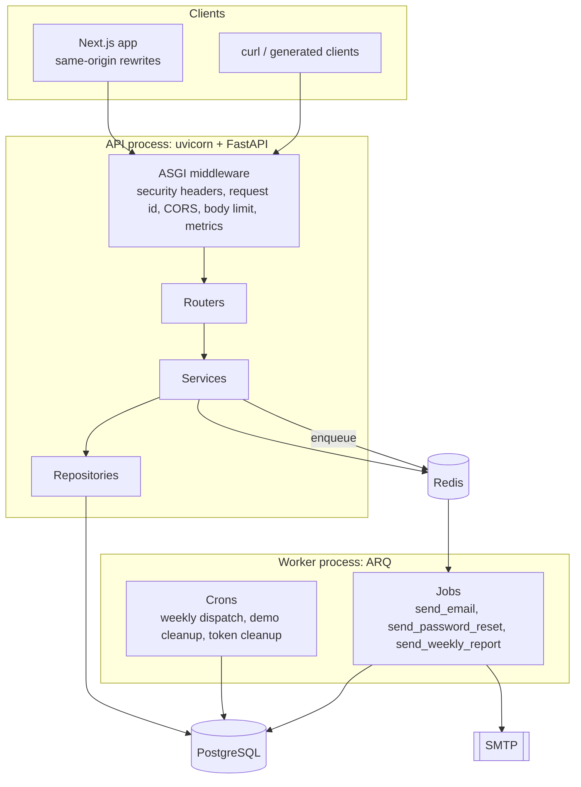
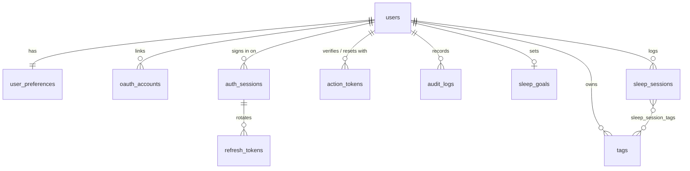
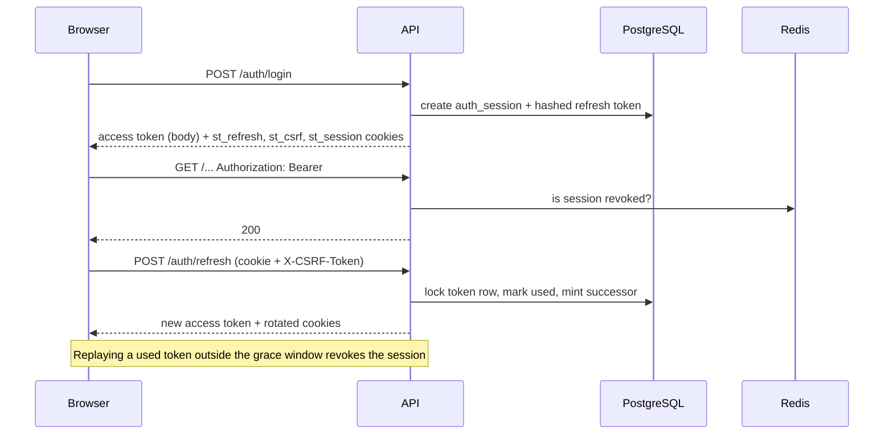

# Architecture

This document describes how the SleepTrack backend is put together and why. Decisions with real
trade-offs are recorded separately as [ADRs](adr/).

## Runtime topology



- **API**: a stateless FastAPI app built by `app.main.create_app()`. Shared resources (engine,
  session factory, Redis client, rate limiter, job queue, email sender, OAuth registry, insight
  provider) are created in the lifespan handler and stored on `app.state`; dependencies read them from
  there, which keeps tests free to build an app with their own settings.
- **Worker**: an ARQ process (`app.worker.settings.WorkerSettings`) that shares the same code and
  settings. Jobs receive a `JobResources` bundle in their context. With `JOBS_EAGER=true` the API runs
  the same job functions in-process, which the test suite and single-container deployments use.
- **PostgreSQL** stores everything durable. **Redis** holds short-lived state: rate-limit counters,
  access-token revocations, OAuth state, analytics cache entries and the job queue.

## Request lifecycle

Middleware is pure ASGI (no `BaseHTTPMiddleware`) and ordered outermost first:

1. `SecurityHeadersMiddleware`: `nosniff`, `DENY` framing, CSP (strict for JSON, relaxed for the
   docs pages), referrer and permissions policies, HSTS when cookies are secure.
2. `RequestContextMiddleware`: accepts a well-formed incoming `X-Request-ID` or generates one, binds it
   to the logging context, adds `Server-Timing`, writes the access log, and converts any exception
   that escapes the app into a generic 500 problem without internals.
3. `TrustedHostMiddleware` (production only).
4. `CORSMiddleware`: explicit origins from `CORS_ORIGINS`, credentials allowed.
5. `BodySizeLimitMiddleware`: rejects bodies over `MAX_REQUEST_BODY_BYTES` based on
   `Content-Length` and while streaming, so a missing or false header can't bypass it.
6. Prometheus instrumentation, then routing.

Inside a route, dependencies resolve the request-scoped `AsyncSession`, the current user (JWT
validation plus a Redis revocation check), and the service. Routers do no business logic: they call
one service method and return a Pydantic model.

## Module layout

```
app/modules/<feature>/
    router.py        HTTP layer
    service.py       use cases, transactions, domain errors
    repository.py    queries
    models.py        SQLAlchemy models
    schemas.py       Pydantic models
    dependencies.py  wiring
```

Modules may import each other's services and repositories but never routers. Cross-cutting code lives
in `app/core` (configuration, security, errors, middleware, logging, rate limiting, pagination) and
`app/db`. External systems are behind protocols in `app/integrations` (email providers, OAuth
providers) so they can be swapped and faked in tests.

### Unit of work

The request-scoped `AsyncSession` is the unit of work. Services stage changes and call `commit()`
explicitly once a use case has succeeded; the dependency rolls back anything left over when the
request ends. Making commits explicit (instead of committing in the dependency's teardown) means the
response is never sent before the transaction is durable, and side effects that must follow a commit,
such as enqueuing an email, are visibly placed after it.

Timestamps are generated in Python (with server defaults as a fallback) so values are present on the
instance after a flush; under asyncio, an expired attribute would otherwise trigger an implicit lazy
load and fail.

## Data model



Integrity rules live in the database as well as in the services:

| Rule | Enforcement |
|---|---|
| One account per email (case-insensitive) | unique index on `lower(email)` |
| Tag names unique per user (case-insensitive) | unique index on `(user_id, lower(name))` |
| Ratings 1-5, latency 0-240, awakenings 0-50, notes up to 2000 chars | check constraints |
| `ended_at > started_at`; status matches presence of `ended_at` | check constraints |
| Completed sessions never overlap | `EXCLUDE USING gist (user_id WITH =, tstzrange(started_at, ended_at) WITH &&)` |
| At most one running timer per user | partial unique index `WHERE status = 'in_progress'` |

Indexes back the hot paths: `(user_id, night_of)` for analytics ranges, `(user_id, started_at)` for
listing and overlap checks, a trigram GIN index on `notes` for `ILIKE` search, and partial indexes for
active sessions and demo-account cleanup. Enumerations are stored as `VARCHAR` with check constraints,
which are easier to evolve than native PostgreSQL enums.

All constraints have deterministic names from a naming convention, so Alembic autogenerate produces
stable, reviewable migrations. CI runs `alembic upgrade head`, `alembic check` (models and migrations
agree) and `alembic downgrade base` on every push.

## Authentication

See [ADR 0002](adr/0002-token-strategy.md) for the reasoning. In short:



- Access tokens are HS256 JWTs with `sub`, `sid` (device session), `role`, `jti`, `iss`, `aud`
  and a 15 minute lifetime.
- Refresh tokens are 256-bit random strings stored as SHA-256 digests. Each belongs to an
  `auth_session` (one per signed-in device). Rotation marks the presented token as used under a row
  lock and issues a successor. A used token presented again is either a benign race (within
  `REFRESH_REUSE_GRACE_SECONDS`, rejected without side effects) or a replay, which revokes the
  session, writes a `token_reuse_detected` audit entry and emails the user.
- Revoking a session (logout, device removal, password change or reset, reuse, admin disable) writes
  `auth:revoked:sid:<id>` to Redis for the remaining access-token lifetime, so outstanding access
  tokens stop working immediately.
- Cookie-authenticated endpoints (`/auth/refresh`, `/auth/logout`) require the `X-CSRF-Token` header
  to equal the readable `st_csrf` cookie.

## Analytics pipeline

1. `SleepRepository.completed_points()` loads every completed session in the requested `night_of`
   range with its tag ids in **one** grouped query (`array_agg`), returning lightweight
   `SessionPoint` dataclasses instead of ORM objects.
2. Pure functions in `calculations.py` and `builders.py` compute nights, circular means, scores,
   streaks and so on. They have no I/O and are unit-tested directly.
3. Results are cached in Redis per user, endpoint and range. Every write that can change analytics
   (sessions, tags, goals, timezone) increments a per-user version number embedded in the cache key,
   so invalidation is O(1) and stale entries simply expire.

The insight service builds an `InsightContext` from the same data and hands it to an
`InsightProvider`. The default `RuleBasedInsightProvider` is a list of small rule functions; each
produces explainable insights tied to numbers shown elsewhere in the UI. The formulas are documented in
[analytics.md](analytics.md).

## Background jobs

| Job | Trigger | Purpose |
|---|---|---|
| `send_email` | enqueued | Render a Jinja2 template (HTML + text) and send it |
| `send_password_reset` | enqueued by `/auth/forgot-password` | Look up the account, issue a single-use token, email it |
| `send_weekly_report` | enqueued by `/reports/weekly/email` | Build and email a weekly report |
| `dispatch_weekly_reports` | cron, hourly at :00 | Send last week's report to users for whom it is 08:00 on the first day of their week |
| `dispatch_bedtime_reminders` | cron, every 15 min | Email opted-in users 30 minutes before their goal bedtime, in their timezone |
| `cleanup_demo_accounts` | cron, :15 and :45 | Delete demo accounts older than `DEMO_ACCOUNT_TTL_HOURS` |
| `cleanup_expired_tokens` | cron, 03:30 daily | Purge sessions and action tokens expired or revoked over a week ago |

Jobs are idempotent where it matters: weekly dispatch and bedtime reminders take a Redis `SET NX`
guard per user and week (or night),
and a failure for one user is logged without stopping the batch. See
[ADR 0004](adr/0004-arq-background-jobs.md).

## Errors

Services raise subclasses of `AppError` (`SessionOverlapError`, `TokenExpiredError`, ...), each with an
HTTP status and a stable `code`. Handlers convert those, validation errors and Starlette HTTP errors
into `application/problem+json`. Unhandled exceptions are logged with a traceback and returned as a
generic 500 with the request id, never with internal details. See
[ADR 0003](adr/0003-problem-details.md).

## Observability

- **Logs**: structlog, JSON in non-development environments (pretty console locally), with request id,
  user-safe redaction of sensitive keys and one access-log line per request.
- **Metrics**: `prometheus-fastapi-instrumentator` at `/metrics` (request counts and latency
  histograms by route template).
- **Health**: `/health/live` (process up) and `/health/ready` (database and Redis reachable, with
  per-check latency; 503 when degraded).
- **Tracing and errors**: optional OpenTelemetry (FastAPI + SQLAlchemy instrumentation, OTLP/HTTP
  exporter) and Sentry, enabled by environment variables and installed via the `observability` extra.

## Testing strategy

- Unit tests for pure logic (analytics, insight rules, security, settings, middleware, integrations
  with fakes).
- Integration tests through the real ASGI app with `httpx.ASGITransport`, a fresh migrated
  `sleeptrack_test` database and a dedicated Redis database. Tables are truncated between tests.
  Background jobs run eagerly and emails land in an in-memory outbox so flows such as "register,
  open the verification link" are tested end to end.
